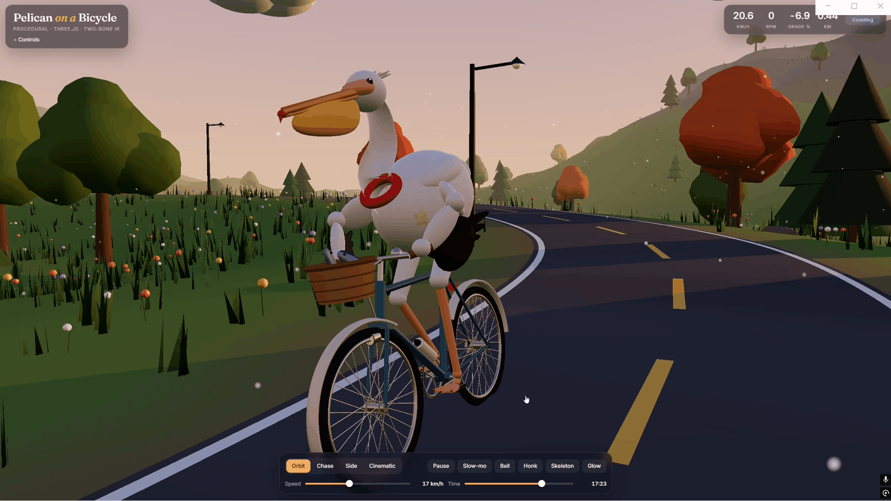
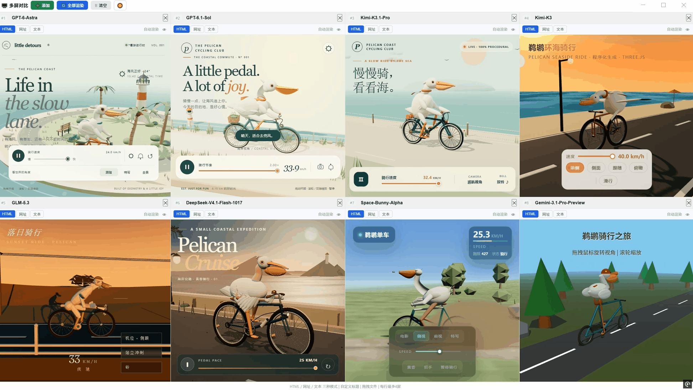

# Pelecanus

**One Prompt. Multiple LLMs. Different 3D Worlds.**

[在线体验 · GitHub Pages](https://niaonao.github.io/pelecanus/) · [GitHub 仓库](https://github.com/niaonao/pelecanus)

## 关于项目

Pelecanus 是一个 AI 创意实验和交互式 3D 画廊。不同的大模型从同一个提示词出发，用 Three.js 创作“一只正在骑自行车的鹈鹕”。打开作品，可以比较各个场景的视觉风格、运动节奏和交互方式。

<details>
<summary>查看原始提示词</summary>

```text
使用 Three.js 创建一个精致、可交互的 3D 网页场景：一只鹈鹕正在骑自行车。

鹈鹕、自行车、环境、动画、灯光、摄像机和交互均通过程序实现。鹈鹕需要真实地骑自行车，并具有协调的腿部、脚踏、车轮和身体运动。

不要使用 SVG、2D Canvas、外部 3D 模型或预渲染动画。

最终输出一个可以直接在现代浏览器中运行的完整 HTML 文件。
```

灵感来源见 [Artificial Analysis 的鹈鹕骑自行车 SVG 挑战](https://artificialanalysis.ai/microevals/generate-an-svg-of-a-pelican-riding-a-bicycle-1777416860523)。

</details>

## 代表作品

### Claude Opus 5.5 · Pelican on a Bicycle

鹈鹕沿着秋日公路骑行。[打开交互作品](https://niaonao.github.io/pelecanus/html/Claude-Opus-5.5.html)

[](https://niaonao.github.io/pelecanus/html/Claude-Opus-5.5.html)

### 八件作品的并排实录

从海岸公路到低多边形林间小路，八件作品各自诠释同一次骑行。[进入画廊](https://niaonao.github.io/pelecanus/#gallery)



## Gallery · 全部作品

| 作品来源 | 在线体验 |
| --- | --- |
| Claude Opus 5.5 | [打开作品](https://niaonao.github.io/pelecanus/html/Claude-Opus-5.5.html) |
| Claude Fable 5.2 | [打开作品](https://niaonao.github.io/pelecanus/html/Claude-Fable-5.2.html) |
| Claude Sonnet 5 | [打开作品](https://niaonao.github.io/pelecanus/html/Claude-Sonnet-5.html) |
| DeepSeek V4.1 Flash 1017 | [打开作品](https://niaonao.github.io/pelecanus/html/DeepSeek-V4.1-Flash-1017.html) |
| DeepSeek V4.1 Flash | [打开作品](https://niaonao.github.io/pelecanus/html/DeepSeek-V4.1-Flash.html) |
| GLM 5.3 Flash | [打开作品](https://niaonao.github.io/pelecanus/html/GLM-5.3-Flash.html) |
| GLM 5.3 | [打开作品](https://niaonao.github.io/pelecanus/html/GLM-5.3.html) |
| GPT-5.6 Luna | [打开作品](https://niaonao.github.io/pelecanus/html/GPT-5.6-Luna.html) |
| GPT-5.6 Sol | [打开作品](https://niaonao.github.io/pelecanus/html/GPT-5.6-Sol.html) |
| GPT-6 Astra | [打开作品](https://niaonao.github.io/pelecanus/html/GPT-6-Astra.html) |
| GPT-6.1 Sol | [打开作品](https://niaonao.github.io/pelecanus/html/GPT-6.1-Sol.html) |
| Gemini 3.1 Pro Preview | [打开作品](https://niaonao.github.io/pelecanus/html/Gemini-3.1-Pro-Preview.html) |
| Gemini 3.6 Flash | [打开作品](https://niaonao.github.io/pelecanus/html/Gemini-3.6-Flash.html) |
| Gemini 3.8 Flash | [打开作品](https://niaonao.github.io/pelecanus/html/Gemini-3.8-Flash.html) |
| Hy4 Preview | [打开作品](https://niaonao.github.io/pelecanus/html/Hy4-Preview.html) |
| Kimi K3.1 Pro | [打开作品](https://niaonao.github.io/pelecanus/html/Kimi-K3.1-Pro.html) |
| Kimi K3 | [打开作品](https://niaonao.github.io/pelecanus/html/Kimi-K3.html) |
| Muse Wonder | [打开作品](https://niaonao.github.io/pelecanus/html/Muse-Wonder.html) |
| Qwen 3.8 Max | [打开作品](https://niaonao.github.io/pelecanus/html/Qwen-3.8-Max.html) |
| Space Bunny Alpha | [打开作品](https://niaonao.github.io/pelecanus/html/Space-Bunny-Alpha.html) |
| Step 5 Preview | [打开作品](https://niaonao.github.io/pelecanus/html/Step-5-Preview.html) |

## 项目目录

```text
pelecanus/
├── .gitignore
├── index.html     # 画廊首页
├── html/          # 独立的 Three.js 作品 HTML，见上表
├── img/
│   ├── gif.gif
│   ├── opus5.5.gif
│   └── Artificial Analysis Intelligence Index (11 Nov '26).png
├── README.md
└── LICENSE
```

## 本地体验

下载或克隆仓库，在项目根目录启动静态文件服务器。

```bash
python -m http.server 8000
```

在支持 WebGL 的现代浏览器中打开 [本地画廊](http://localhost:8000/)。部分作品通过 CDN 加载 Three.js，需要联网。拖拽旋转、缩放或调节骑行速度等操作以各作品内的提示为准。

## License

[Apache License 2.0](./LICENSE)
