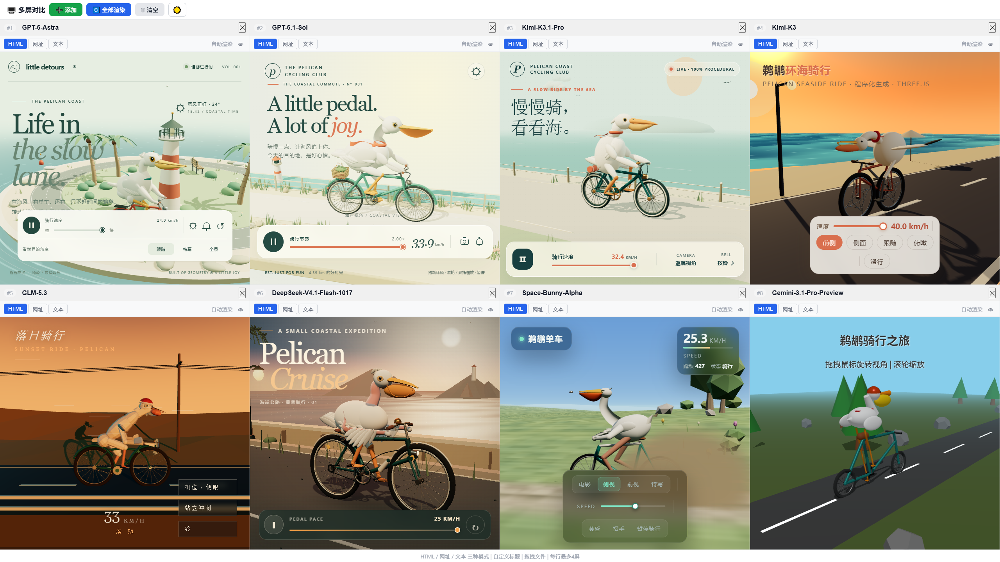
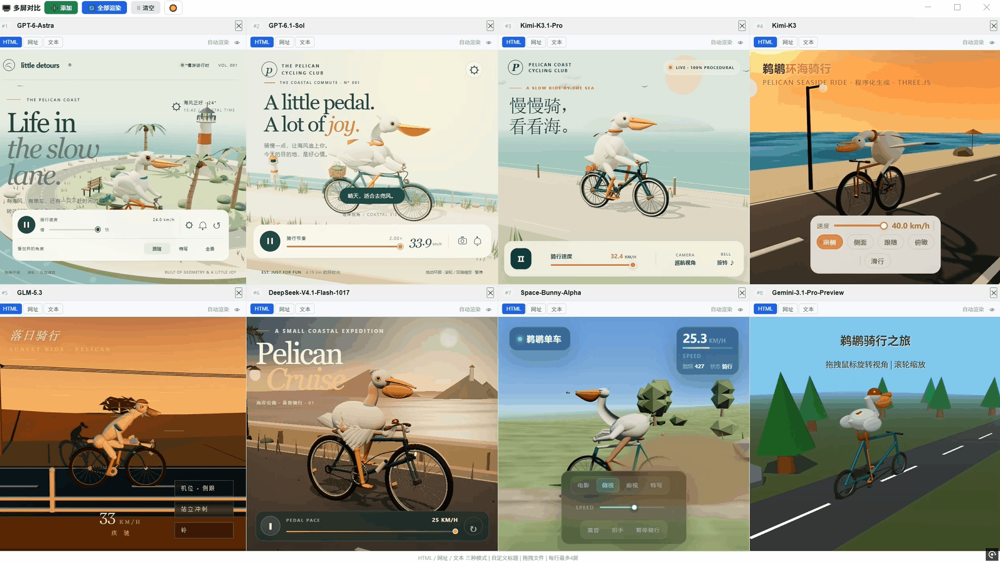

# Pelecanus · 鹈鹕骑行 3D

同一个提示词，不同大模型，会创造出怎样的 3D 世界？

本仓库收录了 19 个由不同大模型及其版本生成的 Three.js 单文件作品，围绕“一只鹈鹕正在骑自行车”，展示程序化建模、骑行动画和交互效果。保留模型原始输出，不对作品排名。





最新更新（2026-10-24）：新增 Kimi K3.1 Pro，更新大模型测评结果对比图，见下方作品列表。

## 作品一览

| 模型 | 查看作品 |
| --- | --- |
| Claude Sonnet 5 | [打开 HTML](html/Claude-Sonnet-5.html) |
| DeepSeek V4.1 Flash | [打开 HTML](html/DeepSeek-V4.1-Flash.html) |
| DeepSeek V4.1 Flash 1017 | [打开 HTML](html/DeepSeek-V4.1-Flash-1017.html) |
| Gemini 3.1 Pro Preview | [打开 HTML](html/Gemini-3.1-Pro-Preview.html) |
| Gemini 3.6 Flash | [打开 HTML](html/Gemini-3.6-Flash.html) |
| Gemini 3.8 Flash | [打开 HTML](html/Gemini-3.8-Flash.html) |
| GLM 5.3 | [打开 HTML](html/GLM-5.3.html) |
| GLM 5.3 Flash | [打开 HTML](html/GLM-5.3-Flash.html) |
| GPT-5.6 Luna | [打开 HTML](html/GPT-5.6-Luna.html) |
| GPT-5.6 Sol | [打开 HTML](html/GPT-5.6-Sol.html) |
| GPT-6 Astra | [打开 HTML](html/GPT-6-Astra.html) |
| GPT-6.1-Sol | [打开 HTML](html/GPT-6.1-Sol.html) |
| Hy4-preview | [打开 HTML](html/Hy4-Preview.html) |
| Kimi K3 | [打开 HTML](html/Kimi-K3.html) |
| Kimi K3.1 Pro | [打开 HTML](html/Kimi-K3.1-Pro.html) |
| Muse-Wonder | [打开 HTML](html/Muse-Wonder.html) |
| Qwen 3.8 Max | [打开 HTML](html/Qwen-3.8-Max.html) |
| Space-Bunny-Alpha | [打开 HTML](html/Space-Bunny-Alpha.html) |
| Step-5-Preview | [打开 HTML](html/Step-5-Preview.html) |

## 快速体验

下载或克隆仓库后，在项目根目录启动静态文件服务器：

```bash
python -m http.server 8000
```

访问 [GPT-6 Astra 示例](http://localhost:8000/html/GPT-6-Astra.html)，或将地址末尾替换为上表中的 HTML 文件名。

使用支持 WebGL 的现代浏览器；部分作品通过 CDN 加载 Three.js，需要联网。常见操作包括拖拽旋转、滚轮缩放、暂停动画和调节速度，具体以各页面提示为准。

## 挑战与提示词

本项目将经典的“鹈鹕骑自行车”SVG 测试升级为可交互的 3D 挑战，重点观察角色与自行车的空间结构，以及腿部、脚踏、曲柄和车轮之间的运动协调。各模型使用以下提示词：

```text
使用 Three.js 创建一个精致、可交互的 3D 网页场景：一只鹈鹕正在骑自行车。

鹈鹕、自行车、环境、动画、灯光、摄像机和交互均通过程序实现。鹈鹕需要真实地骑自行车，并具有协调的腿部、脚踏、车轮和身体运动。

不要使用 SVG、2D Canvas、外部 3D 模型或预渲染动画。

最终输出一个可以直接在现代浏览器中运行的完整 HTML 文件。
```

## 参考与演示

- 项目说明：[CSDN 博客](https://blog.csdn.net/niaonao/article/details/165008168) · [掘金文章](https://juejin.cn/post/7684937171811221513)
- 视频演示：[Bilibili](https://www.bilibili.com/video/BV11GYv6oEJG/)
- 经典测试题来源：[Artificial Analysis：Generate an SVG of a pelican riding a bicycle](https://artificialanalysis.ai/microevals/generate-an-svg-of-a-pelican-riding-a-bicycle-1777416860523)

**AA 智能榜单参考（2026-10-24）**

以下为 Artificial Analysis Intelligence Index 的 2026-10-24 榜单快照，图片定期手动更新。点击图片可查看最新交互榜单；该综合智能榜单供背景参考，不代表本仓库鹈鹕骑行作品的排名。

[](https://artificialanalysis.ai/models#intelligence)

来源：[Artificial Analysis](https://artificialanalysis.ai/models#intelligence)。

## 许可与说明

采用 [Apache License 2.0](LICENSE) 许可证。模型名称仅标识作品来源，本项目与相关厂商无官方隶属或背书关系；作品效果受模型版本、提示词及运行环境影响。
